<p align="center">
  
</p>

<p align="center">
  
  
  
</p>

A small desktop converter written in Python and Tkinter. The window has two panels. **Fiat** converts between 33 world currencies, and **Crypto** prices 39 coins in any of those currencies. Both fetch the rate at the moment you press Convert, so the result is never a stale table.

Watch the [demo video](Currency_Conerter_Demo.mp4) (MP4, 15 MB).

## Quick start

```bash
git clone https://github.com/JustKamlesH21/PyCurrencyConverter.git
cd PyCurrencyConverter
pip install requests          # Tkinter ships with Python
python main.py
```

Fiat conversion works straight away. Crypto conversion needs a CoinMarketCap API key (see below).

## How it works

<p align="center">
  
</p>

| Panel | Rate source | Key needed |
|---|---|---|
| Fiat | `https://api.exchangerate-api.com/v4/latest/<FROM>` | No |
| Crypto | CoinMarketCap Pro, `v2/tools/price-conversion` | Yes |

The fiat panel reports timeouts, network errors and bad amounts in the result line. The crypto panel shows a plain `Error` for any failure.

### Using your own CoinMarketCap key

The key is set in `main.py` as `api_key_cmc` (and in `Functions/Crypto_Function.py` for the command-line version). Get a free key at [coinmarketcap.com/api](https://coinmarketcap.com/api/) and put yours there.

## Supported codes

**Fiat (33):** USD EUR INR GBP JPY AUD CAD CHF CNY NZD SGD HKD SEK KRW ZAR MXN BRL TRY RUB PLN THB IDR PHP SAR AED EGP NOK DKK HUF ILS TWD UAH VND

**Crypto (39):** BTC ETH BNB SOL XRP ADA DOGE SHIB AVAX DOT LINK LTC TRX MATIC UNI BCH XLM ICP FIL APT IMX NEAR ETC ATOM XMR HBAR VET QNT GRT AAVE MKR EOS ALGO SAND MANA AXS FTM PEPE WIF

To add one, append its code to `currency_list` or `crypto_list` in `main.py`.

## Project layout

| Path | What it is |
|---|---|
| `main.py` | The Tkinter app |
| `Functions/Currency_Function.py` | The fiat conversion as a terminal prompt |
| `Functions/Crypto_Function.py` | The crypto conversion as a terminal prompt |

## License

No license file has been added yet, so default copyright applies.

<p align="center">
  <a href="https://github.com/JustKamlesH21"></a>
</p>
